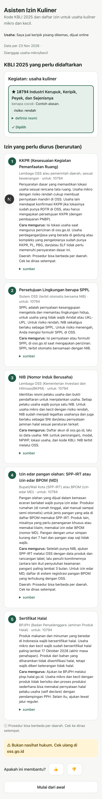

# Asisten Izin Kuliner

An assistant that helps small food and beverage businesses in Indonesia (UMKM kuliner) pick the
right **KBLI 2025** code for their OSS/NIB registration and see which **permits** follow from it.
The owner describes the business in plain Indonesian. The app answers with one to three suggested
KBLI codes, the risk level, and the permits to get, in order, each with its legal source.

Picking the wrong KBLI code leads to the wrong permits and a revision later, and both steps are
confusing for a first-time registrant. This project is also a portfolio piece: a small, honest
RAG application with a curated data set, a rules engine, an eval harness and containerised
deployment. All user-facing copy is in Indonesian.

<p align="center">
  
</p>

*Result screen in fake mode (canned LLM answers), captured by the Playwright smoke test.*

> **Disclaimer.** The app shows "Bukan nasihat hukum. Cek ulang di oss.go.id" on every answer.
> It is a drafting aid, not legal advice. Always confirm against OSS and the cited regulations.

## How it works

```
 browser ──> web (Next.js, :3000) ──> api (FastAPI, :8000) ──> Postgres 17 + pgvector (:5433)
                                         │
                                         └──> LLM: DeepSeek (default, deepseek-flash, OpenAI-compatible API)
                                              or Claude (Opus 5.5, anthropic SDK) via LLM_PROVIDER
```

1. **Retrieve.** The description is embedded with `BAAI/bge-m3` (local, 1024 dims) and matched
   against KBLI titles and definitions in pgvector, merged with keyword search by reciprocal rank
   fusion (at most 20 candidates per activity).
2. **Select.** The LLM picks one primary code and up to two alternatives, from the candidate list
   only. It may ask at most two clarifying questions, in one round.
3. **Rules.** Risk levels and permits come from a rules engine over hand-curated data rows, never
   from the model. Every permit and rule carries its source regulation, URL and `last_verified`.
4. **Log.** Each request is stored in `query_log` with the data release behind the answer.

Design details: [docs/design.md](docs/design.md). Project rules: [CLAUDE.md](CLAUDE.md).

## Quick start (fake mode, no API key)

Fake mode uses canned LLM answers and hash-based embeddings. It is for trying the app and for
tests, and its answers are **not** representative of real quality.

Prerequisites: Docker (with Compose), [uv](https://docs.astral.sh/uv/), Node 22 with corepack,
and `make`.

```bash
cp .env.example .env          # works as-is: fake mode, local database
make setup                    # start Postgres (127.0.0.1:5433), migrate, load data/*.yaml
corepack pnpm@10.28.2 --dir web install
make dev                      # API on :8000, web on :3000 (Ctrl-C stops both)
```

`make dev` and the `full` container profile both use ports 8000 and 3000: stop one before starting the other.

Open <http://localhost:3000>. Check the API with `curl http://localhost:8000/healthz`.

### Everything in containers

```bash
cp .env.example .env
docker compose --profile full up --build -d
docker compose --profile full run --rm api python -m app.data.loader /app/data
```

The web app is on <http://localhost:3000>, the API on <http://localhost:8000>. The `api` image
bundles the bge-m3 weights (no download at start), runs as a non-root user, applies migrations on
start, and contains `data/`. The API's CORS allow-list is `CORS_ORIGINS` (default `http://localhost:3000`). `NEXT_PUBLIC_API_URL` is inlined into the web bundle at build time:
set it in `.env` (or the shell) before `--build` if the browser must reach the API elsewhere.
Stop with `docker compose --profile full down` (add `-v` only if you mean to delete the database).

### Real mode

Real answers need an LLM provider and the real embedder. Set in `.env`:

```bash
LLM_MODE=real
EMBEDDER=bge
LLM_PROVIDER=deepseek   # default; or claude
```

**DeepSeek (default, low cost).** Create a key at <https://platform.deepseek.com> and add
`DEEPSEEK_API_KEY=sk-...` to `.env`. The model is `deepseek-flash` (override with
`DEEPSEEK_MODEL`). DeepSeek has JSON mode but no schema-enforced output, so the API puts the
JSON Schema in the prompt, validates every reply with Pydantic and retries once; a reply that
still fails is treated like a refusal ("tidak dapat diproses" / "tidak yakin"). Logged cost uses
DeepSeek's peak rates (US$0.30 in / US$1.20 out per 1M tokens for `deepseek-flash`, checked
2026-11-24), so it errs high. Note that requests go to DeepSeek's API servers; descriptions are
redacted of NIK, phone numbers and emails before they leave the API.

**Claude.** Set `LLM_PROVIDER=claude`, then either add `ANTHROPIC_API_KEY=sk-ant-...` to
`.env`, or run `ant auth login` once and leave `ANTHROPIC_API_KEY` out of `.env` entirely (an
empty `ANTHROPIC_API_KEY=` line would override the profile).

The containers only get `DEEPSEEK_API_KEY` / `ANTHROPIC_API_KEY` when set (in the shell or
`.env`); the `ant` profile lives on the host and is not mounted, so the `full` profile needs a
key.

Then reload the data so the KBLI embeddings come from bge-m3 (the first run downloads about
2 GB of weights to the Hugging Face cache):

```bash
make data-load
make dev
```

In containers, build and run with the same `.env`, then run the loader as above. Do not mix
embedders: a data release loaded with `EMBEDDER=fake` gives poor retrieval under `bge`, so reload
after switching.

## Commands

| Command | What it does |
|---|---|
| `make dev` | Start db, apply migrations, run API (:8000) and web (:3000) |
| `make dev-api` / `make dev-web` | Run one side only |
| `make check` | ruff format and lint, mypy, pytest, web lint, typecheck, vitest |
| `make e2e` | Playwright smoke test against a running fake-mode stack |
| `make setup` | Start db, apply migrations, load data (non-destructive) |
| `make db-reset CONFIRM=1` | **Deletes** the local database (all loaded data and query logs) with `docker compose --profile full down -v` (this also stops the `full` containers), then starts db, migrates and loads `data/` with the configured `EMBEDDER`. Refuses without `CONFIRM=1` |
| `make data-load` | Validate `data/*.yaml` and insert a new data release |
| `make data-sample` | Write a random spot-check sheet to `docs/spot-checks/` |
| `make eval` | Eval dry run: case count and cost estimate, no API calls |
| `make eval EVAL_ARGS=--yes` | Real eval against the configured LLM provider (costs money) |
| `make eval-gen` | Regenerate expected permits in `evals/cases.yaml` |
| `docker compose --profile full up --build` | The whole stack in containers |

The `make e2e` test expects a fake-mode stack: `LLM_MODE=fake EMBEDDER=fake` (the `.env.example`
defaults), data loaded, and the app running on :3000 and :8000.

## Data and sources

The KBLI 2025 list (Peraturan BPS 7/2025), the permits and the rules (PP 28/2025 and the
implementing regulations for food) are curated by hand into `data/*.yaml` and loaded as an
immutable, versioned data release. Rows are never deleted; rows that stop being valid get
`valid_to`. Answers show "Data per <date>" and a visible warning when a row was last verified
more than 183 days ago.

- [data/SOURCES.md](data/SOURCES.md) lists every source and decision.
- Its [Known limitations](data/SOURCES.md#known-limitations) section is required reading. For
  example, rare higher-risk sub-activities are not modelled, and one halal deadline still needs
  re-verification once the regulation text is published.
- Scope: food and beverage only, national-level permits with regional notes, micro and small
  businesses assumed. Medium-sized businesses and tax registration are out of scope.

## Evals

`evals/cases.yaml` holds the eval cases (single and multi-activity, out-of-scope, tricky). The
harness runs the real pipeline over them and writes a report to `evals/reports/`.

```bash
make eval                        # dry run: prints case count and cost estimate
make eval EVAL_ARGS=--yes        # real LLM API (LLM_PROVIDER), costs money; needs `make data-load` with bge
LLM_MODE=fake EMBEDDER=fake make eval   # free plumbing check, labelled as fake
```

The Phase 1 bars are KBLI top-3 >= 0.90 and out-of-scope accuracy (expected-out cases answered
out of scope) >= 0.95 with zero invented codes or permits. The report also shows 3-way scope
accuracy (in / partial / out) and splits every metric by clarified vs not clarified cases. **The baseline report against the real model is still pending**, so there are no quality
numbers yet. `evals/reports/example-fake.md` only shows the report format.

## Project status

Phase 1 of 5: a working local app (retrieval, selection, rules, UI, logging, evals). It is **not
yet ready for staging**. Open items before Phase 1 counts as done:

- the owner's data spot-check ([docs/spot-checks/](docs/spot-checks/));
- the owner's review of the eval cases ([evals/REVIEW.md](evals/REVIEW.md));
- the paid real-model eval baseline (`make eval EVAL_ARGS=--yes`) meeting the Phase 1 bars.

There are no users yet, and no accuracy claims are made. Operations:
[docs/runbook.md](docs/runbook.md).
